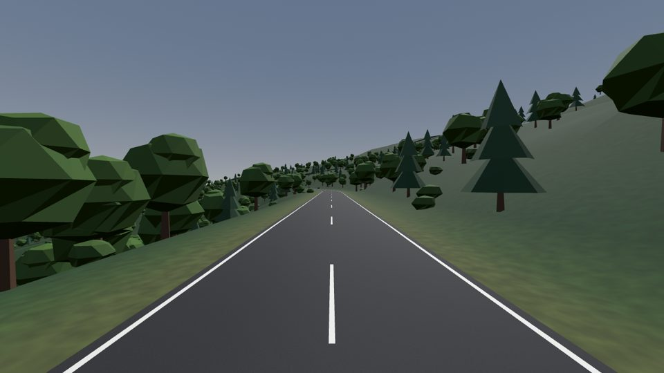
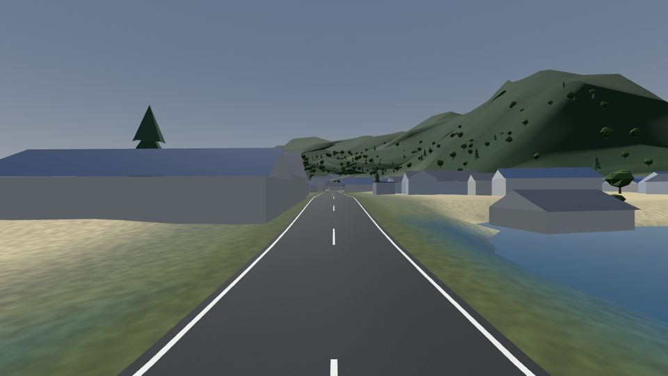

# Real-world adventures: a staged plan

Written 20 October 2026. Supersedes the magazine integration plan. Builds on `docs/real_world_roads_report.md` (the data
and feasibility findings), the route branch's baker (`tools/route_bake.py`), and `main`'s adventure mode (Adventure Rider
magazine, `AdventureRoute`, streamed chunks with a floating origin, forks, junctions, traffic, police, needs, stops,
destinations, satnav, paper map, diary).

## The end goal

The crew stands in front of a screen in the shed, plans a road journey together on a map, and tells the game "this is
the adventure we want". The game makes the adventure and streams it in as they ride. The magazine becomes a feed of
routes people have planned and ridden.

Every stage below is a playable adventure loop on its own, and each one builds a piece of the technology the end goal
needs. Nothing is thrown away between stages: the pack format grows, the loader grows, the planner moves from a tool
to the game to a service, and the planning screen arrives in the shed one feature at a time.

## What the ship game's plan teaches us

The attached "Real Coast" plan is for a boat game, but its shape fits ours exactly, and we take these from it:

- **A region request file** drives a bake: a few lines (box, theme, which real places play which roles, hand-placed
  things no dataset has). Ours is the issue file, grown into a region file.
- **A pipeline of small re-runnable stages with cached outputs** (fetch, project, reconcile, mesh, style, harbours,
  buildings, navigation, landmarks, package), so a styling change does not re-download anything.
- **Reconcile rules between sources that disagree.** Their coastline is the truth over the DEM. Ours: the road line is
  the truth over the DEM (the road is cut into the land), the coastline is the truth over both, buildings level their
  own ground.
- **Style from land cover**: colour and scenery come from real land cover classes through the theme's palette, so the
  place looks like itself and still looks like our game.
- **A hand-edit overlay** per region: fixes recorded in a separate file so re-running the pipeline never loses them.
- **A report** with budgets per chunk and warnings (thin data, conflicts), failing the build when a budget is blown.
- **`sources.yaml` and a credits screen** generated from what each region actually used.
- **A standalone viewer** to judge a region before it goes into the game.
- **Real scale is real**: pick regions accordingly. For us that is a feature (a 25 km ride is 25 km), not a problem.

## More of the data

The feasibility work used heights and roads. There is a great deal more, all open, and most of it maps straight onto
things the adventure mode already draws procedurally:

| Data | Source | Gives the ride |
| --- | --- | --- |
| Heights | Mapterhorn (national lidar 0.5 to 10 m; Copernicus 30 m elsewhere), AWS Terrain Tiles fallback | the land and the road's climbs |
| Roads | Overture transportation: class, surface, width, lanes, one-way, speed limits, bridge and tunnel flags, connectors, names and route numbers | the road, its surface, the satnav, the police's limits, bridges and tunnels, signs |
| Junction types | OpenStreetMap tags on the same roads: roundabout, mini-roundabout, traffic signals, stop and give way | the junction kinds the adventure mode already builds, placed where they really are |
| Water | Overture base: sea, lakes, rivers, streams; coastline | the sea with the coast as the truth, lakes beside the road, river bridges |
| Land cover | ESA WorldCover 10 m: tree cover, shrub, grass, cropland, built-up, bare, snow, water, wetland, mangrove, moss | the land's colours, fields and walls, where the woods are, moor and rock |
| Trees | Meta/WRI canopy height 1 m | how tall the trees are, hedgerows along lanes |
| Buildings | Overture buildings: footprints, heights, floors, class (house, church, shop, industrial, barn) | villages and towns in our style, the pub and the church where they are |
| Places and points of interest | Overture places and OSM: fuel stations, cafes, restaurants, pubs, viewpoints, campsites, hotels, shops, bike dealers, car parks | the stops the needs system wants, fuel where it really is, destinations |
| Named things | Overture divisions (towns, villages, localities), OSM peaks, passes, lighthouses, castles, waterfalls | the satnav and signs, landmarks seen from far off, magazine copy |
| Land use | OSM landuse: farmland, orchard, quarry, industrial, residential, cemetery | field patterns, what stands beside the road |
| Lighting and furniture | OSM street lamps, bus stops, benches, post boxes, phone boxes | village detail at night, bus stops for the traffic's buses |
| Sea depth (coasts) | GEBCO 450 m, EMODnet 115 m in Europe | water colour and the view from a cliff road; nothing to ride |

The adventure mode draws all of these from noise today. Each stage below swaps one group of them for real data.

## The stages

Each stage names the playable loop it delivers, what it builds, the data it adds, how co-op works, how it is tested,
and a rough size. Sizes are for one engineer and are guesses to plan around, not promises.

### Stage 0: where we are (done)

- `main` has the full adventure loop on procedural roads from a seed.
- The route branch has the baker (heights, roads, names, buildings, sea floor, a route of a chosen length with turn
  instructions, an issue file) and a working single-map route mode behind a command-line switch.

### Stage 1: a real road in the magazine

**Playable loop.** Open Adventure Rider, read about the Shodoshima coast road (and one UK route), pick it, choose the
length as today, ride it with the crew to the destination banner, photo, diary. Everything that works on a procedural
adventure works on it: the floating origin streaming, the satnav, traffic and police, fuel, needs, the paper map.

**Builds.**
- The baker writes one continuous corridor per route instead of legs: `route.json` (line and turns), heights as 512 m
  tiles down the corridor, roads and buildings per tile, a `sources.yaml` and a report.
- `AdventureRoute.plan_real(pack, km)` fills the knot arrays (`px`, `pz`, `ph`, `hd`, `curv`, `width`, surfaces) from
  the baked route line resampled every 4 m, heights from the tiles along the line, smoothed and grade-limited by the
  existing rules, truncated at the chosen `km` with the finish and destination placed there.
- `RealTerrain`: a thread-safe sampler of the height tiles, in the route frame, that `AdventureRoute.natural_height`
  reads instead of noise when a real pack is set. Chunks, props and sea use it unchanged.
- An article carries a route id instead of a seed. The route hash goes in the co-op handshake and the shed's
  adventure state, so everyone rides the same bytes.
- Procedural forks and junctions are switched off on real routes for now; real ones come in stage 3.

**Data added.** None beyond heights and roads; the work is plumbing.

**Co-op.** As today: the host starts it from the magazine; the route hash replaces the seed.

**Test.** The crew rides 25 km of Shodoshima from the magazine in co-op, 30 km out after an origin shift they still see
each other, frame time on par with a procedural ride, the existing suite green.

**Size.** About 2 weeks. The big risk to settle in week one: real grades and widths outside the planner's limits
(15.5 % and 3.3 to 7.4 m). Decide between clamping (a flatter road) and lifting the limits for real routes.

### Stage 2: the place looks like the place

**Playable loop.** The same ride, but the woods are where the woods are, the fields have walls and hedges where the
land cover says cropland, the village is the real village with its church and pub shapes, the sea meets a real
coastline, and the peak you can see from the pass has its name on the satnav. The magazine article can say "look out
for the lighthouse at the point" and mean it.

**Builds.**
- The pipeline becomes the ship plan's staged one: fetch, project, reconcile, style, buildings, navigation (our signs
  and names), landmarks, package; each stage cached; a report with per-chunk triangle and draw budgets and warnings;
  `sources.yaml` and the credits screen entry generated from it.
- Reconcile: coastline over DEM (land never smears into the sea, cliffs stay cliffs), roads over DEM, buildings level
  their ground. Lakes and rivers get their own water.
- Style from land cover through the theme palette: colours, tree species and density (canopy height for size),
  fields with walls or hedges, moorland, bare rock, built-up ground.
- Real buildings in our style with kinds from the data (house, church, pub, barn, industrial); real place-name signs;
  named peaks, passes and lighthouses as landmarks the far-ground renderer draws and the satnav names.
- Bridges and tunnels from the road flags, using the adventure mode's existing tunnel builder where the data says
  tunnel.
- The hand-edit overlay: a per-route file of fixes (move a building, drop a road, widen a bend) applied after the bake.
- `pack_preview.py` grows into the standalone viewer: fly the route, toggle overlays (land cover, water, buildings,
  signs, chunk budgets), drop a test bike on the road.

**Data added.** Land cover, canopy height, water, buildings with classes, divisions and named natural features, land use.

**Co-op.** Unchanged.

**Test.** Someone who knows Shodoshima recognises it from screenshots. Every chunk is within its budget. A UK dales
route and a Japanese coast route both bake with no hand edits.

**Size.** About 3 weeks.

**Status.** Part one is built (`claude/real-roads-2`): the baker fetches Overture land cover, land, land use, water,
buildings and places (`tools/land_bake.py`) and writes per-tile cover rasters, building boxes with a kind and a
height, and named landmarks into the pack (format 4); the game tints the land and thins or thickens woods, bushes and
rocks by cover, fences only farmland, builds the real buildings in the game's style on levelled ground, places real
lighthouses, and the sat nav shows the real road's name. Every chunk of the Shodoshima road is checked against a
vertex and instance budget (`test_budget`). Still to do in this stage: the staged cached pipeline with its report
and `sources.yaml`, real water meshes for lakes and rivers, bridges and tunnels from the road flags, peaks and passes
named on the sat nav, the hand-edit overlay, the standalone viewer, and the UK dales route that bakes with no
hand edits. Place names without an English form (most of Shodoshima's) are left blank for now, by choice; they can
be romanised or shown as the data has them later.

### Stage 3: the whole adventure loop on real places

**Playable loop.** A 100 km epic across a real region: fuel at real filling stations, lunch at a real cafe, the night's
sleep at a real village hotel, the police with the real speed limits, a real side road voted on at a fork, roundabouts
and traffic lights where the real ones are, and a destination that is a real place (a famous viewpoint, a bike cafe, a
circuit).

**Builds.**
- Points of interest become sites: fuel, cafe, pub, hotel, campsite, viewpoint, car park; the needs and stops systems
  read them instead of planning their own.
- Real junctions: the route's junction nodes become the adventure mode's junction sites, with the real side roads as
  arms (real names on the signs), and the junction type (roundabout, lights, give way) from the tags.
- Real forks: a second-best path between two points of the route, planned by the baker, offered to the crew as a way
  to vote on with its real length, surface and bends.
- Speed limits from the data into the police and the signs. One-way and turn restrictions respected by the planner.
- The destination set piece placed at a real place picked in the issue file, with the magazine blurb written from the
  data (what it is, how far, what is on the way).

**Data added.** Places and points of interest, junction tags, speed limits, restrictions.

**Co-op.** Unchanged; forks vote as today.

**Test.** An epic with a night stop rides end to end in co-op. The needs test passes on a real route.

**Size.** About 3 weeks.

**Status.** Built (`claude/real-roads-3a` and `claude/real-roads-3b`): the baker writes `pois.json` (filling stations, cafes,
pubs, inns, campsites, lay-bys and viewpoints within reach of the road), `junctions.json` (side roads, found from the
road graph, and roundabouts found from the road's shape: the data has no roundabout flag), `forks.json` (the second-best
way between two junctions, a road of its own on chunk boundaries) and a speed limit per chunk (posted where the data
has one, else the country's default for the class, lower where built up); it takes via points and classes to avoid,
and the road graph is cut at the connectors part-way along a segment (it was missing most junctions). The game's
planned stops move to the nearest real place of their sort and take its name, side roads join where the real ones do,
a real fork is a fork like any other (ways, signpost, vote; the sat nav and the police follow the path taken),
speed-limit signs stand by the road, and the police and traffic keep to the real limits. The Dales epic (70 km from
Settle to Leyburn, one fork, real stops, a night at an inn, the Dales rally at the end) is in the magazine, and a co-op
test rides it end to end: the same copy of the road, the vote, the other way, a night at the inn, and arrival.

What the data cannot give us: traffic lights (there are none in it, so the game keeps making its own in villages) and
buildings along a fork's other way (the baker only finds them along the main road; the other way has none yet). Still to
do in this stage: one-way and turn restrictions in the planner, the destination set piece placed at a real place picked
in the issue file rather than by the theme, and more forks per road (the baker keeps only those whose line a bike can
ride).

### Stage 4: choose your own route from a region

**Status.** Built for Shodoshima: `tools/region_bake.py` bakes a region (13 MB for the island: its 4,300 junctions and
5,300 roads as a graph, and the three-level land, 8,400 buildings, places and landmarks beside any road);
`RealRegion` loads it; `RoutePlanner` plans a journey over it in GDScript on a worker thread (Dijkstra with a cost per
class for Quick, Scenic and Tracks, spurs to dead-end pins left out, bends smoothed by revisiting only what moved, the
real heights graded, junctions and roundabouts, buildings, places and speed limits) and a 24 km route plans in about
0.7 s. It matches the baker's own road for the same two pins (length within 4 %, heights within 1 m). The shed's map
(`JourneyMap`, from the magazine) shows the island shaded by height with its roads, pins from anyone in the crew are
shared (`AdventureJourney`, in the shed's state), and the host's Start makes an adventure carrying the plan; every
game plans it again (`AdventurePlans`, cached by the plan's key) and the hash says they got the same road
(`tests/mp_journey.gd` runs two processes through it). The gaps are now closed too: the baker keeps one-way roads (five
on Shodoshima) and prohibited turns (none in this area's data) and the planner drives one-way roads their way only
and never takes a banned turn (its search is over arrivals, with the straight-line distance as a floor); the map has
a search box over the region's 47 named towns and villages, named places to stop and landmarks, suggested places
with nothing typed, and the towns named on the map; a planned road has forks (the second-best way between two of its
junctions, as the baker finds them) the crew votes on; and regions can be downloaded (`RegionStore`: a zip from the
index's URL, its hash checked against the index's before it is put under `user://regions`, where `RealRegion` finds it
beside the bundled ones; `tools/region_zip.py` makes the zip and the index entry). Nothing is hosted yet; Shodoshima
and the Dales are bundled.

Since then the route planner is a channel on every shed TV (`RouteTv`), and the magazine and the made-up roads are
gone: every adventure is a journey planned over a real region. `Adventure.start` takes a plan, `AdventureWorld.setup`
lays the ride out along the planned road (`AdventureRoute.plan_real`), and the ride ends at the last pin (the crew
parked together past the finish for the photo). The procedural road generator (its bends, climbs, switchbacks,
tunnels and made-up forks and junctions), the themed set pieces at the destination and the baked single routes
(`data/routes`) were removed; a region's theme still dresses its land (Shodoshima coastal, the Dales hills), and a
crossroads in a built-up place gets traffic lights, which the map doesn't record. The tests ride the bundled regions'
tours (`AdventurePlans.TOURS`, `tests/rides.gd`).

**Playable loop.** An issue is now a *region* (the whole of Shodoshima; a 60 by 60 km square of the Dales). Its article
shows the region's map on the shed screen with a few suggested destinations. The host picks a start, a destination and
waypoints by pointing at the map; the crew sees the pins and votes on waypoints the way they vote at forks; the route
is planned in the game and the ride streams from the region's tiles. This is collaborative planning, on a region we
baked.

**Builds.**
- Region packs: tiles for a whole area, not a corridor: heights at 4 m along every road and coarser (10 to 20 m) away
  from them, roads as a graph, buildings, land cover and points of interest per tile. A region is a download of
  100 to 300 MB.
- A route planner in the game (GDScript, on a thread): shortest path with class costs over the region's road graph,
  through waypoints, with turn instructions, restrictions and a choice of "main roads", "scenic" or "tracks" weighting.
  `AdventureRoute.plan_real` then builds the road from the planned line as in stage 1.
- The shed screen's map: the region drawn from its tiles (the paper map's style), place search within the region, pins
  for start, waypoints and destination, the planned route drawn with its length and estimated time, a "Start this
  adventure" button for the host.
- Co-op: pins and votes in the shed's shared state; the route is replanned on every machine from the same pins and
  the same region hash, so it is identical without sending geometry.

**Data added.** None new; the same data over a whole area.

**Test.** The crew plans a 40 km route across a region on the screen, with two waypoints, and rides it. Replanning after
a pin moves takes under a second on a thread. Two machines plan the same route from the same pins.

**Size.** About 4 weeks.

### Stage 5: anywhere on Earth

**Status.** Stages 5 and 6 are redesigned in `docs/ride_anywhere_plan.md` (22 October 2026), now that the magazine
is gone and every adventure is planned on the shed TV: the whole world on the TV, cells baked on request by a service
and cached, a frame per journey, the crew agreeing the route and a ready-check in co-op, and journeys kept and
shared. What follows is the earlier design, kept for the reasoning.

**Playable loop.** Search for any place, or paste a map link from a phone, and ride there. The first ride somewhere new
starts after a short wait while the road ahead is made; a route ridden once rides again offline.

**Builds.**
- The route service: the baker as a stateless web service that makes a stretch of corridor (about 2 km, with its land,
  roads, buildings and points of interest) on request from a pinned data release, with a cache in front of it. The
  magazine's regions are pre-baked and shipped, so the service is only needed off the beaten track.
- The game asks the service for stretches a few kilometres ahead of the riders, as its chunk builder already asks the
  route, and keeps a disk cache. The host pins the data release and the crew fetches the same stretches.
- Link parsing: a Google Maps share link gives the start, waypoints and end as coordinates; only those coordinates are
  used (Google's terms forbid building a game's roads from its map data), and the road comes from open data.
- A fallback where the data is thin (no lidar, few roads): the report says so before the ride starts and the planner
  avoids it where it can.

**Data added.** None new; all of it, on demand.

**Test.** A 2 km stretch arrives in under 5 seconds from a warm service; a route anywhere with lidar rides within a
minute of planning; a ride with the service switched off still rides from its cache.

**Size.** About 5 weeks plus hosting. The latency figure is a guess until measured; measuring it is the first week.

### Stage 6: planning together, and the magazine as a feed

**Playable loop.** The crew stands at the shed screen with a world map. Anyone can search, drop and drag pins, and the
route redraws for everyone; the group settles it by vote; the host starts it. Rides are saved with their real map into
the diary, and a route can be shared as a code or a link. The magazine's issues become the best routes people have
ridden and shared, with their photos.

**Builds.** The shared planning screen (world map tiles, search, drag, vote), route codes, the magazine feed, and the
authoring viewer for us to curate issues.

**Size.** About 3 weeks after stage 5.

## The technology ladder

How each piece grows across the stages, so nothing is built twice:

| Piece | Stage 1 | Stage 2 to 3 | Stage 4 | Stage 5 | Stage 6 |
| --- | --- | --- | --- | --- | --- |
| Pack | a corridor of tiles | plus land cover, water, buildings, points of interest, overlay | a region of tiles with a road graph | stretches served on demand | the same |
| Planner | the baker, offline | the baker, offline | in the game, over the region graph | in the game, over served tiles | the same, shared |
| Loader | `AdventureRoute.plan_real` and `RealTerrain` | the same | the same, over a region | the same, over a cache fed by the service | the same |
| Planning UI | the magazine page | the magazine page | the shed map screen with pins | plus search anywhere and links | shared, with votes and sharing |
| Co-op | route hash | route hash | region hash plus pins | release pin plus pins | the same |

## How the land is drawn, and streaming it

A real road's land is drawn the way the garage map's is (`scripts/real_land.gd`, after `WorldTerrain`): the road's own
chunks keep the road, its verge and the collision out to 110 m, and everything beyond is a grid of 512 m blocks over the
real heights, each at a near (8 m cells), middle (32 m) or far (64 m) level by how far the rider is from it, with
skirts hiding the cracks between levels. A block beside the road is always at the near level, the road's own blend
into the land is worked out exactly in the band where the two meet (so they join without a line), and the skyline
(`RealRidges`) is eased down under the blocks. Valleys open out and hills climb away from the road instead of the road
running down a corridor of strips (the strips had fifteen columns to a kilometre: a valley 300 m across was two flat
facets).

The blocks ask the terrain one thing, the height (and the cover) at x, z, so where the heights come from is the terrain's
business alone. **Heights can stream with no server of ours**: Mapterhorn serves its elevation as ordinary map tiles
over HTTP, so a `RealTerrain` that fetches the tiles round the rider on demand, keeps them in a disk cache and feeds
the same three levels would make any road on Earth ridable with real heights. Roads, buildings and places cannot
stream directly (Overture ships them as large data files, not tiles), which is what Stage 5's route service is for:
it turns a start and an end into those layers for the stretch asked for, cached by content hash.

## Pack size and delivery

**Three levels of land.** A pack's land is held at three levels (`tools/levels.py`, `scripts/real_terrain.gd`): fine
(4 m samples out to 320 m, where terrain and buildings need detail), coarse (32 m out to 1.7 km, the hillsides the land
mesh runs up) and ridge (128 m out to 14 km, the skyline, drawn as its own mesh by `RealRidges`). The finer levels'
outer edges are baked eased into the next coarser level, so there is no step. Tiles are stored as differences,
zlib-compressed. Shodoshima went from 11 MB to 2 MB with the same visible reach, and a 100 km road comes to
roughly 8 MB. The ridge level is baked pushed down 90 m near the road so the land mesh always hides it, and meets the
real height about a kilometre out, where the land mesh's own real heights end.

**Download when the crew agrees the route** (from Stage 4, when the route is chosen in the shed). The crew agrees a
small recipe (start, end, waypoints, seed, data release, baker version). Packs are content-addressed by their hash,
the same hash the co-op check uses today. Choosing a route starts a ready-check: each machine that lacks the pack
fetches it into `user://routes/<id>-<hash>/`, verifies the hash, and shows progress at the shed screen; the ride
starts when everyone has it. Magazine roads are hosted as release assets or in an object store; from Stage 5 the
route service bakes them on demand. One bundled road (Shodoshima, 2 MB) stays in the game so it plays offline.

**Keep it afterwards?** Yes, with a size cap. A saved overnight stop resumes into the same road, the diary and photos
refer to it, and crews re-ride favourites. Keep downloaded packs least-recently-used up to a cap (say 1 GB), never
evict the road of a saved adventure, and offer "delete downloaded roads" in the settings. Nothing needs the data
once the adventure is over and ended, so a small cap loses nothing but a re-download. ODbL allows caching and
redistributing the packs with their credits.

## Cross-cutting rules

- **One frame.** Everything real lives in the route frame of the adventure mode (doubles, floating origin). The baker
  writes tiles in a local metric frame per region; the loader turns tile coordinates into route coordinates once.
- **Reconcile in this order:** coastline, then roads, then buildings, then the DEM. Each later source gives way to the
  earlier where they disagree.
- **Style belongs to the game.** Data decides where things are and what kind they are; the theme palette and our meshes
  decide how they look. No imagery, ever.
- **Budgets.** Every chunk has a triangle and draw-call budget and the report fails a bake that blows it.
- **Hand edits survive re-bakes** through the overlay file; nothing is ever edited in a baked file by hand.
- **Credits.** `sources.yaml` per region or route, and a credits entry generated from it. ODbL share-alike applies to
  any road data we redistribute; the packs' road layers are published under it.
- **Determinism.** The same inputs and the same data release give the same bytes; every co-op machine checks a hash.

## Risks, and where they are retired

| Risk | Retired in |
| --- | --- |
| Real grades and widths outside the planner's limits | stage 1, week 1 |
| Thin data where there is no lidar (30 m surface model with buildings in it) | stage 2 (reconcile and report), stage 5 (fallback) |
| Chunk budgets with real building density in towns | stage 2 |
| Points of interest missing or mis-tagged (no fuel for 80 km) | stage 3 (the report warns; the overlay adds one) |
| Region pack size | stage 4 (coarse tiles away from roads) |
| Service latency and cost | stage 5, week 1 |
| Google Maps terms | stage 5 (coordinates only) |
| Japan GSI terms for redistributed heights | before the first shipped Japanese region |

## What to do first

Stage 1. It is the smallest step that puts a real road into the loop everyone already plays, and its first week answers
the one question that shapes everything after it: how far the adventure mode's road rules can bend to a real road.
