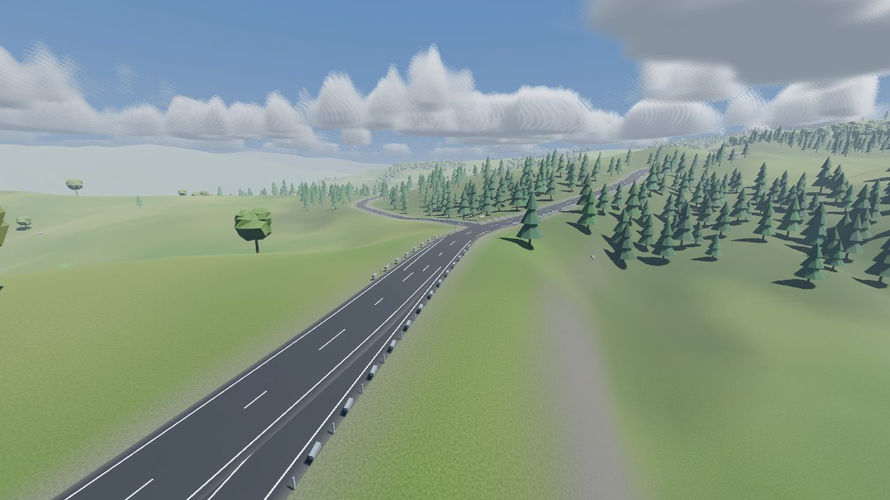
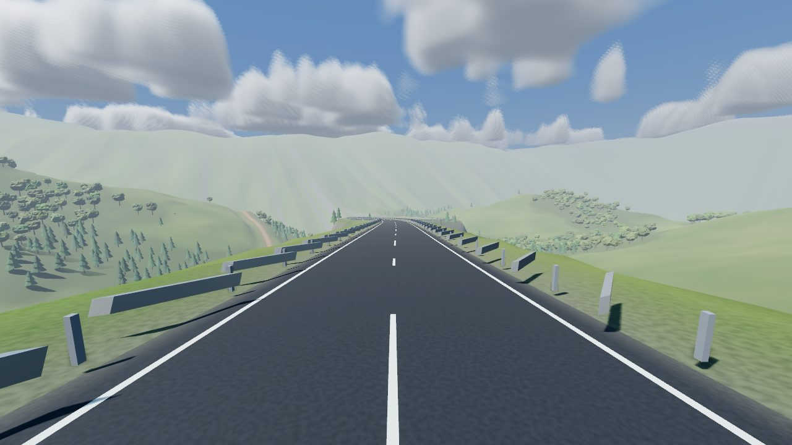
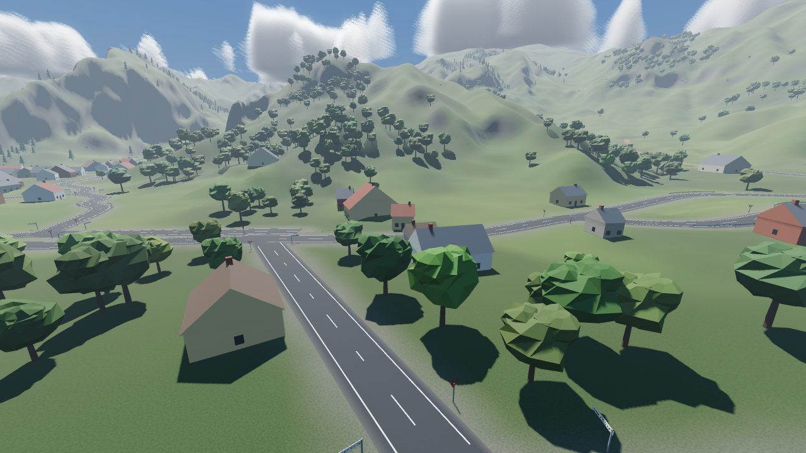
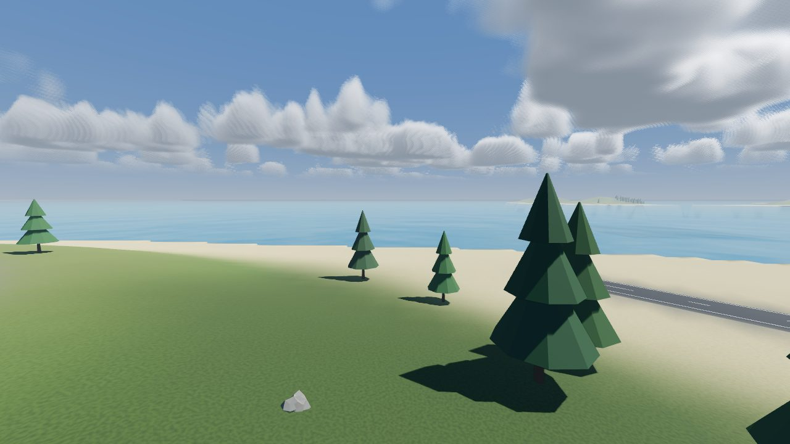
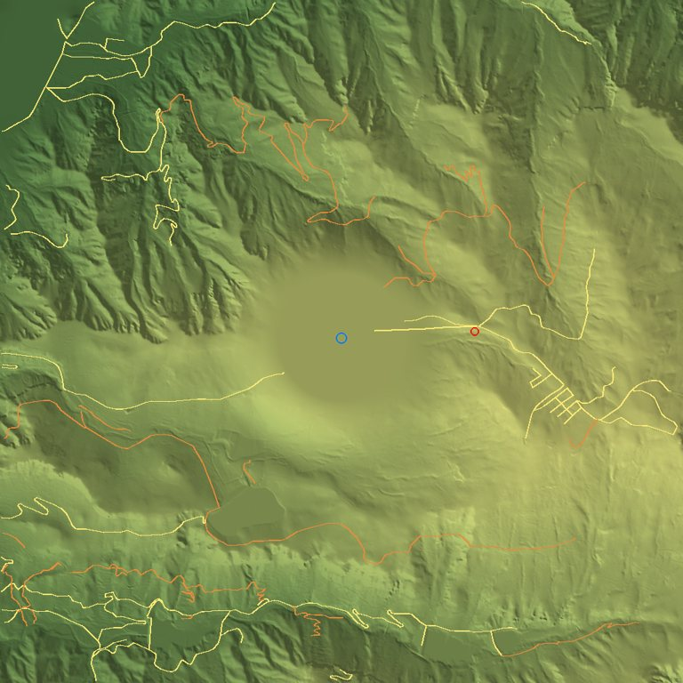

# Real-world roads for Adventure Mode: feasibility report

Written 20 October 2026. The living copy with the pipeline diagram is the shared doc; this file keeps the findings next to the code.

## Summary

Feasible, and simpler than it looks. BeamNG.Earth does **not** use Google Earth. It streams free, openly licensed
elevation (Mapterhorn, AWS Terrain Tiles) and road data (Overture Maps, built on OpenStreetMap) through its own
Python server, so the data we want is usable in a shipped game with attribution and no keys. Imagery is the only
non-commercial layer (Sentinel-2 2023 is CC BY-NC-SA) and we do not want it: we colour the ground ourselves.

**Recommendation.** Do not run BeamNG.Earth. Build a Python *bake tool* that turns an issue (start, end, corridor)
into a *route pack* of height tiles and road lines, lifting BeamNG.Earth's elevation and ground-filter code under
MIT, and a streaming layer in Godot that feeds those tiles into the `WorldTerrain` and `WorldRoads` structures the
game already reads. Live go-anywhere fetching can be added later as a second source behind the same interface.

**Why.** A magazine issue is a curated, deterministic, offline download. A baked pack is exactly that, and live
streaming is not. Co-op, offline play, licensing and launch-day load all get easier.

**Cost.** About two weeks to ride a real road statically (this branch's proof of concept), six to eight more for
streaming and origin rebasing over long routes, then two to three weeks of issue-authoring features.
The main risk is not data or code but real roads being less game-like than hand-laid ones, so each issue needs a
curation pass.

## What BeamNG.Earth does

[TecnaGamer/BeamNG.Earth](https://github.com/TecnaGamer/BeamNG.Earth) (MIT, v1.5.3-beta, 19 Oct 2026) is a Python
companion server plus a Lua mod. The server fetches data, builds terrain and road meshes in a flat local frame
round a moving origin, and streams them over a local socket (BeamNG's Lua cannot reach the internet). The mod loads
tiles, keeps a physics terrain under the car and moves the world origin as the car drives.

| Layer | Source | Notes |
| --- | --- | --- |
| Elevation | Mapterhorn (national lidar where it exists, 0.25 to 20 m), AWS Terrain Tiles, Copernicus GLO-30 30 m fallback | Buildings and tree stands filtered out of surface models |
| Roads, bridges, water, buildings | Overture Maps and OpenStreetMap, NBI and Wikidata for bridge types | Class, width, surface, junctions |
| Imagery | State and national orthophotos, NAIP, Sentinel-2 cloudless | The layer we would not use |
| Land cover, trees | ESA WorldCover, canopy height model | Ground material and tree placement |
| Routing, weather | OSRM, Open-Meteo | Not needed |

Known limits from its release notes: high-speed driving can outrun the road surfaces on a first visit, sessions get
stuttery after about an hour, floating buildings in some regions, bridges are not perfect, and the game pauses
with "Waiting for collision to load" at the loaded edge.

## Where Torque Shed stands

The riding map already has the two structures a real-world feed would fill, and everything else reads from them.

| Piece | Today | Meaning for real roads |
| --- | --- | --- |
| Land | `WorldTerrain`: one 4 km x 4 km grid at 4 m, one `HeightMapShape3D`, 64-cell mesh chunks, near and far LOD | A real DEM is a different way to fill `heights` |
| Roads | `WorldRoads`: control points splined, resampled every 2 m, graded to a climb and crest limit, stamped into the land | Real centre lines replace the control points; grading, meshes and collision stay |
| Surface feel | Wheel rays read a `surface` meta on the collider | Map Overture class and surface to tarmac, dirt, grass |
| Everything downstream | Traffic, props, signs, spawn points | Unchanged if the shapes stay the same |

Not yet there: loading over time (the whole map is built in `World.generate()`) and large coordinates (a 40 km
route needs a floating origin).

## Data

| Need | Source | Access | Licence |
| --- | --- | --- | --- |
| Heights | [Mapterhorn](https://mapterhorn.com/data-access) | `tiles.mapterhorn.com/{z}/{x}/{y}.webp`, 512 px Terrarium; Japan GSI 1, 5 and 10 m, UK 1 m, USA 1 m, GLO-30 elsewhere | Per national source, 151 listed in [attribution.json](https://download.mapterhorn.com/attribution.json) |
| Heights fallback | [AWS Terrain Tiles](https://registry.opendata.aws/terrain-tiles/) | `elevation-tiles-prod/terrarium/{z}/{x}/{y}.png` | Public domain and CC BY per source |
| Roads, water, names | [Overture Maps](https://docs.overturemaps.org/guides/transportation/) | Monthly GeoParquet on S3, anonymous | ODbL; "(c) OpenStreetMap contributors, Overture Maps Foundation" |
| Land cover | ESA WorldCover | Cloud-optimised GeoTIFF | CC BY 4.0 |
| Trees | Meta / WRI canopy height | Cloud-optimised GeoTIFF | CC BY 4.0 |

Licence notes (not legal advice): list every source on a credits screen; treat each issue's road layer as an ODbL
database and publish it as such (the game, art and terrain colouring stay ours); check the Japanese GSI terms once
before the first Japanese issue.

## Options

**A. Run BeamNG.Earth as a sidecar.** Not recommended. It is a 60,000-line Python server shaped round BeamNG's
engine. A sidecar means shipping a Python runtime, a second process, every player fetching their own tiles (so
co-op data can differ), and owning a fork of fast-moving code. Reusable under MIT as a library and a reference:
`dem.py` (tile keys, Terrarium decode, Mapterhorn then AWS failover), `dsmground.py` (surface-to-ground filter),
the road class tables in `roads.py`, the grading numbers in `grading.py`, `netfetch.py` (polite fetching), and the
cell-keyed deterministic design of `mapdata.py`.

**B. Our own live streaming in Godot.** Feasible; most of the work (tiles, loading over time, origin rebasing) is
shared with C. The live fetch adds the hard parts: no simple road tile endpoint (Overture is Parquet or PMTiles
needing a decoder, Overpass is not for production), release pinning for co-op, offline cache, rate limits, and a
volunteer-run tile host on launch day. Roughly 10 to 14 weeks.

**C. Bake per issue, stream from the pack (recommended).** A tool bakes an issue once into a pack; the game streams
tiles from that file. Deterministic in co-op (same pack, same hash), offline, no keys, curated by us, and the live
source of B can slot in behind the same interface later. First rideable road in about two weeks.

| | A: sidecar | B: live in Godot | C: bake per issue |
| --- | --- | --- | --- |
| Fits the magazine product | Poorly | Partly | Exactly |
| Effort to first real road | 3 to 4 weeks | 10 to 14 weeks | 2 weeks static, 6 to 8 streamed |
| Runtime dependencies | Python, DuckDB, internet | Internet, tile host | None |
| Co-op determinism | Hard | Needs release pinning | Trivial |
| Offline | Cache only | Cache only | Always |
| Free-ride anywhere | Yes | Yes | Not until B's source is added |

Risks whichever way: real roads are not game roads (hairpins, single tracks, crossings with no junction geometry,
bridges and tunnels); 30 m height data with buildings in it where there is no lidar; every absolute position
(saves, pings, skid marks, remote players, recovery truck) has to move with a floating origin; and scope creep
towards BeamNG.Earth's buildings, signals and traffic.

## Phased plan

1. **Proof of the seam, static** (about 2 weeks, this branch). A baker that writes a pack for a 4 km square, and a
   `World` that loads it in place of noise and the hand-laid layout. Gate: ride a real road with flush junctions,
   correct surface kinds, and the existing map tests still passing. See `tools/README.md`.
2. **Streaming and rebase** (4 to 6 weeks). Tiles with their own collision, loaded by distance along the route
   on worker threads, roads graded up front, floating origin. Gate: a 40 km route at 100 mph with no hitch over
   16 ms and no jitter at the far end, in a two-player session.
3. **Issue authoring** (2 to 3 weeks). `issue.json`, route finding, water and coast, land-cover driven ground and
   props, real place names on signs, credits screen, pack hash in the co-op handshake.
4. **Polish for real roads** (ongoing). Hairpins, junctions, bridges, tunnels, curation checklist per issue.
5. **Live source, optional** (4 to 6 weeks).

## Proof of concept status

Built on branch `claude/laughing-brahmagupta-l269oq`, off by default and not merged to `main`. See `tools/README.md` and the "Real-world routes" section of the main README.

The first cut (a single static 4 km square) answered the data and seam questions. It has since grown to a route of any
length, in the order you asked for:

- **A long road of a set length, with the satnav.** `tools/route_bake.py` plans a route of `--length-km` (or to an end
  point) along real roads and bakes it as overlapping 4 km legs. The game builds the next leg on a thread as you near
  the end of this one and swaps to it under a quick fade, carrying the bike across at speed. A satnav panel shows the
  next turn, distances and a way back when off route. An issue file (`--issue issue.json`) is the hook for the magazine.
  Streaming in smaller tiles instead of 4 km legs is the next step if the swap's fade ever bothers anyone (the data
  would not change).
- **Sea.** Real coasts get a sloping sea floor, a sand beach and a rippling water sheet; riding in puts you back on the road.
- **Buildings.** Real footprints become houses, sheds and barns in the villages' own style, on levelled ground, facing the road.
- **Junction signs, guard rails.** Give way signs and "junction ahead" boards, and the guard rails fixed (they were being
  stretched along the map's axes, not their own, which left squashed slabs with gaps).
- **Cars, lorries and groups of bikers** share the roads (see the main README).
- **Co-op** checks every player has the same route and changes leg together.

What it has not settled, in order of risk: how hairpins and steep mountain roads ride at speed, how much of a real route
needs hand curation, the 30 m surface-model heights away from lidar, and playing it for an hour (memory over many legs).

## Sources

- [BeamNG.Earth](https://github.com/TecnaGamer/BeamNG.Earth) and its [releases](https://github.com/TecnaGamer/BeamNG.Earth/releases)
- [Mapterhorn](https://mapterhorn.com/data-access), [AWS Terrain Tiles](https://registry.opendata.aws/terrain-tiles/), [joerd attribution](https://github.com/tilezen/joerd/blob/master/docs/attribution.md)
- [Overture transportation](https://docs.overturemaps.org/guides/transportation/), [Overture attribution](https://docs.overturemaps.org/attribution/)
- [OSMF licence FAQ](https://osmfoundation.org/wiki/Licence_and_Legal_FAQ)
- [Godot HeightMapShape3D](https://docs.godotengine.org/en/stable/classes/class_heightmapshape3d.html)
